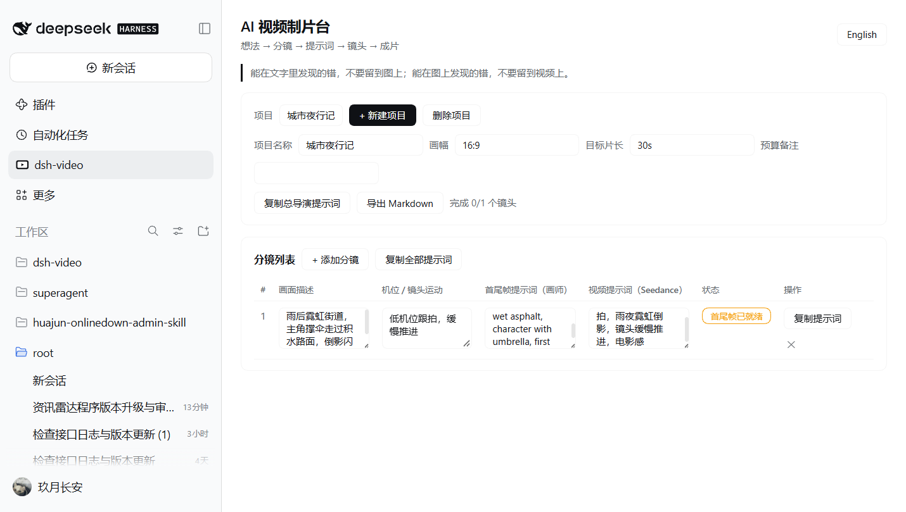
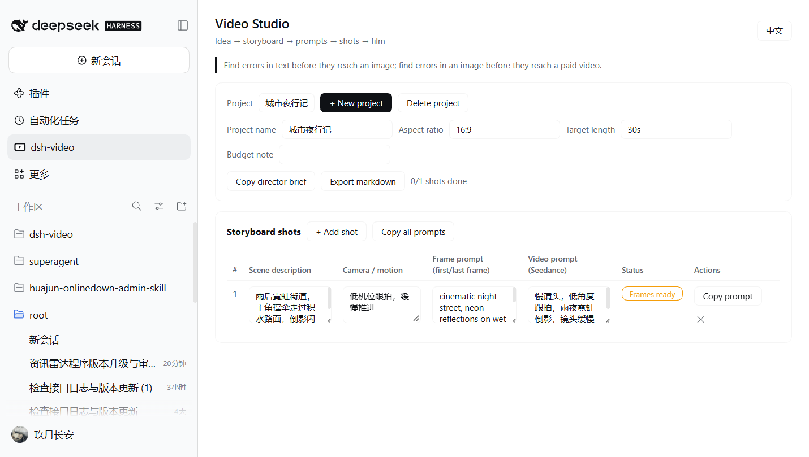
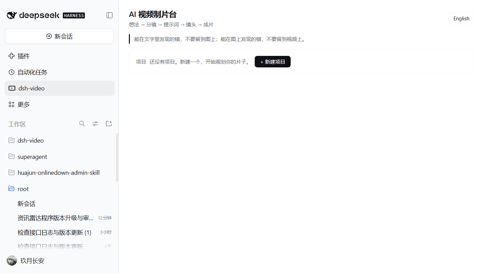

# dsh-video · Video Studio for DeepSeek Harness

[](./LICENSE)
[](https://github.com/topics/dsh-plugin)
[](https://github.com/deepseek-ai/deepseek-harness)

**dsh-video** is a [DeepSeek Harness](https://github.com/deepseek-ai/deepseek-harness) plugin that gives your AI video production workflow a home inside the Harness Web UI. It adds a **Video Studio** panel to the left sidebar where you plan a short film the way multi-model teams actually work: a director (your coding agent) writes the story and prompts, a painter model (e.g. Codex) draws concept art and first/last frames, and an animator model (e.g. Seedance) turns frames into seconds of paid video.

> The workflow this plugin manages was popularized by the article
> *"Claude Code/Codex + Seedance AI video: from an idea to a finished film"* —
> one director agent, cheap text iterations first, expensive video generations last.

| 中文 | English |
| --- | --- |
|  |  |

## Why

AI video is expensive: regenerating a shot costs money by the second, while rewriting a prompt is free. The discipline that keeps costs down — *find errors in text before they reach an image, and in images before they reach video* — needs a place to live. dsh-video is that place: a storyboard sheet, a prompt library, and a shot pipeline, one panel away from your agent sessions.

## Features

- **Sidebar entry** — the Video Studio registers as a global panel in the Harness left sidebar (next to Plugins and Scheduled tasks).
- **Projects** — each short film is a project with aspect ratio, target length, and a budget note.
- **Storyboard shots** — per shot: scene description, camera/motion, painter prompt (first/last frames), and video prompt (Seedance), all editable inline.
- **Shot status pipeline** — cycle each shot through `Draft → Frames ready → Video generated → Final cut`, with a per-project done counter.
- **Copy prompts** — copy one shot prompt, all prompts, or export the whole storyboard as Markdown to hand to your agent.
- **Director brief** — one click copies a battle-tested "you are the director" briefing prompt that sets up the director/painter/animator division of labor and the cost-saving rules.
- **Bilingual** — full Chinese and English UI with a one-click toggle; the default follows your browser language.
- **Local-first** — everything is stored in your browser (`localStorage`); no accounts, no server, no telemetry.
- **Theme-aware** — styled exclusively with Harness theme tokens, so it matches light and dark mode automatically.

## Screenshots

| Empty state (中文) | Storyboard in use (中文) | English UI |
| --- | --- | --- |
|  |  |  |

## Requirements

- A running [DeepSeek Harness](https://github.com/deepseek-ai/deepseek-harness) installation (Desktop app or `dsh web`).
- No build step, no runtime dependencies — the plugin is a plain-JavaScript Cordis bundle.

## Install

Install into any non-desktop Harness profile with the `dsh` CLI:

```sh
# create a profile from the shipped web template (first time only)
dsh video --from-default-profile web

# install the plugin from this checkout
dsh plugin --profile video add /path/to/dsh-video

# serve the UI
dsh video --no-open --host 127.0.0.1 --port 10891
```

Inside the **Desktop** profile, install the bundle through the Harness plugin manager (Plugins → Add → local directory), then restart the app so the new client module generation is loaded.

Alternatively, publish or fork this repository and install by Git URL wherever `dsh plugin add` accepts one.

## Usage

1. Click the **dsh-video** icon in the left sidebar's global panel list.
2. **New project** — name it and set the aspect ratio / target length.
3. **Add shot** — describe the scene, the camera move, and write two prompts: the frame prompt for your painter model and the video prompt for your animator model.
4. Work the pipeline top-down: fix the text first, generate frames, check them, only then generate video, and advance the status badge as each shot completes.
5. **Copy director brief** into a new Harness session to bootstrap the full multi-model workflow with your agent.

## Project structure

```
dsh-video/
├── package.json        # Cordis bundle manifest + dsh.client section
├── cordis.patch.yml    # Loader patch: inserts the dsh-video entry
├── index.js            # Host half (entry activation)
├── client.js           # Client half: sidebar icon, Studio panel, i18n, storage
├── locale/
│   ├── en.json         # Plugin title/description (English)
│   └── zh.json         # Plugin title/description (Chinese)
├── icon.svg            # Original panel icon
├── screenshots/        # Real-app screenshots (light theme, Windows)
└── docs/               # Workflow notes
```

**How it plugs in.** The bundle patch inserts one Loader entry named after the package. On the Client, the module registers two slot factories: an icon into `sidebar.panellist` (the left sidebar's global panel list) and the full panel into the keyed `main` slot under the same id, so selecting the sidebar entry swaps the central pane to the Studio. All styling uses `--dsw-alias-*` theme tokens only.

## Compatibility

| | |
| --- | --- |
| Harness | 0.2.x (client slot API: `sidebar.panellist`, `main`, `__ModuleLoader__`) |
| Plugin API | Cordis bundle + plain-JS client module |
| Locales | `en`, `zh` |

## Contributing

Issues and PRs are welcome. Keep client code plain JavaScript (no build step), route every visible string through the i18n dictionary in `client.js`, and style only with Harness theme tokens.

## License

[MIT](./LICENSE) © 2026 dsh-video contributors

[](https://github.com/deepseek-ai/deepseek-harness)
