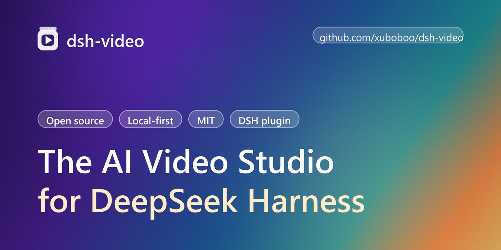
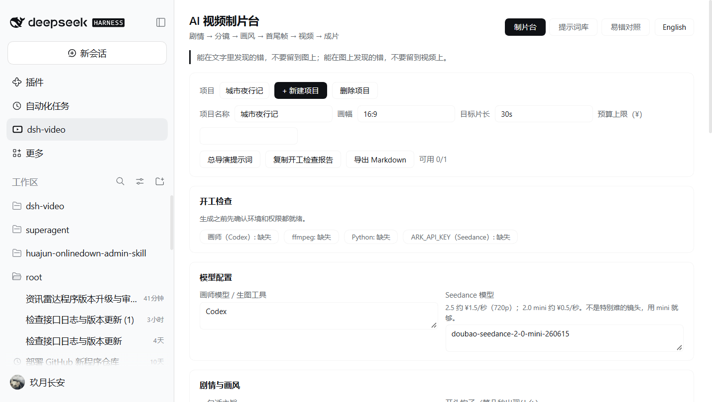
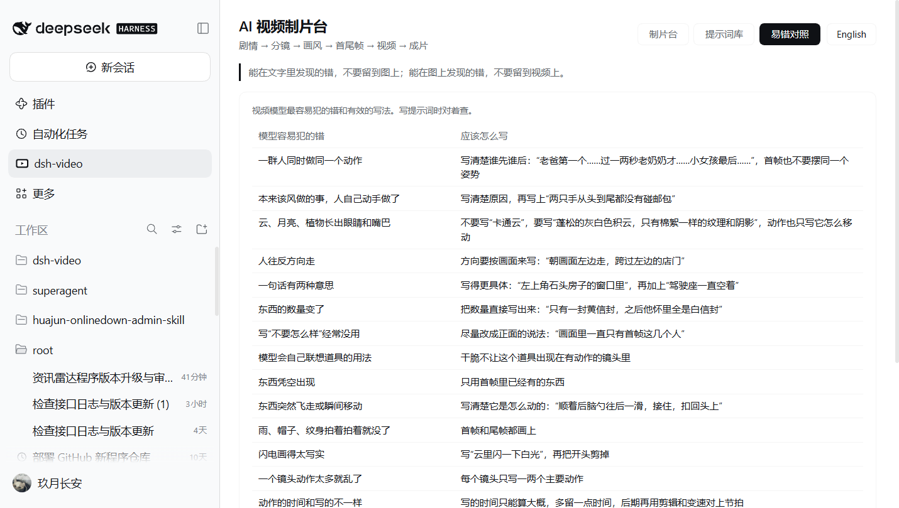
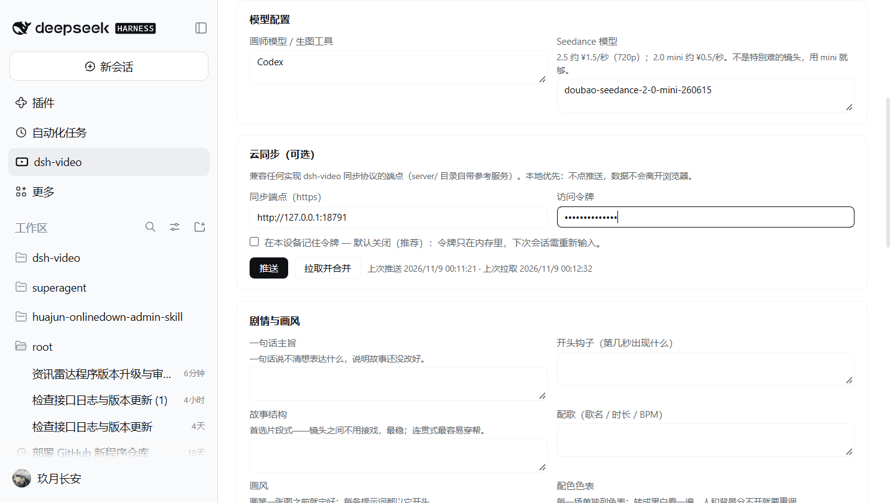
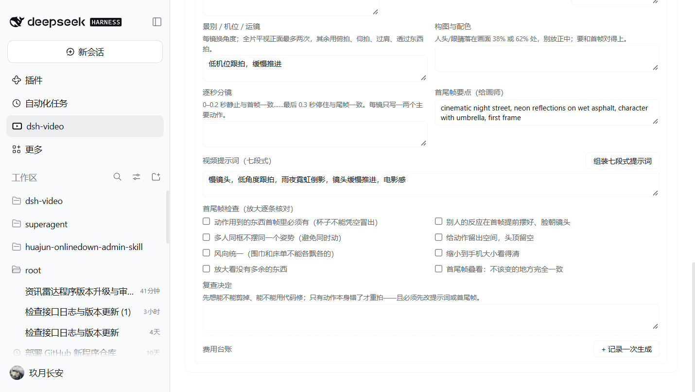

<div align="center">



# DeepSeek Harness 的 AI 视频制片台

**像多模型团队真实协作那样规划 AI 短片——分镜、提示词、镜头流水线，离你的智能体会话只差一个侧栏面板。**

[English](README.md) · [工作流](docs/WORKFLOW.zh-CN.md) ([English](docs/WORKFLOW.md)) · [截图](screenshots/) · [更新日志](CHANGELOG.zh-CN.md) ([English](CHANGELOG.md))

`发布` **v1.0.0** · `协议` **MIT** · `主题` **[dsh-plugin](https://github.com/topics/dsh-plugin)** · `安装` **1 条命令**

[English](README.md) · 简体中文

</div>

---

[](./LICENSE)
[](https://github.com/topics/dsh-plugin)

[English](./README.md) | 简体中文

**dsh-video** 是一个 [DeepSeek Harness](https://github.com/deepseek-ai/deepseek-harness) 插件，为 AI 视频制作工作流提供统一的操作台。它在 Harness 网页界面的左侧栏注册一个「制片台」面板，让你按照多模型协作的真实方式规划短片：导演（你的编码智能体）负责故事和提示词，画师模型（如 Codex）负责设定图与首尾帧，动画师模型（如 Seedance）负责把帧变成按秒计费的视频。

> 本插件管理的流程来自文章《Claude Code/Codex + Seedance AI 视频：从一个想法到成片的全流程》——
> 一个总导演智能体，先在文字上低成本迭代，把昂贵的视频生成留到最后。



## 为什么需要它

AI 视频很贵：重生成一个镜头按秒计费，而改一句提示词是免费的。省钱的核心纪律——**能在文字里发现的错，不要留到图上；能在图上发现的错，不要留到视频上**——需要一个落脚点。dsh-video 就是这个落脚点：分镜表、提示词库、镜头流水线，离你的智能体会话只有一个面板的距离。

## 功能

- **左侧栏入口** —— 制片台注册为 Harness 左侧栏的全局面板（与「插件」「自动化任务」并列），含三个标签页：**制片台**、**提示词库**、**易错对照**。
- **总导演提示词** —— 完整的多模型开工提示词：四方分工（你/导演/画师/动画师）、Codex CLI 调用命令、Seedance API 端点、模型号与 720p 价格（`doubao-seedance-2-5-260628` 约 ¥1.5/秒、`doubao-seedance-2-0-mini-260615` 约 ¥0.5/秒），以及七条工作规矩（审核 agent、新版本存新文件、不充值不买额度等）。
- **开工检查** —— 每个项目的画师工具 / ffmpeg / Python / `ARK_API_KEY` 四项开关，可复制检查报告；环境没就绪就不开工。
- **剧情与画风卡片** —— 一句话主旨、开头钩子、故事结构（片段式 vs 连贯式）、画风、角色设定、配色色表、配歌，每条字段下方印着原文的写作规则。
- **分镜列表** —— 每镜头：发生什么、主要动作、这个镜头是什么在动、与下一镜的衔接、景别/机位/运镜、构图（38%/62% 法则）、生成秒数、逐秒分镜、给画师的首尾帧要点、声音。
- **七段式提示词组装器** —— 一键从字段组装原文的【画风】【镜头】【构图与配色】【人物】【逐秒】【声音】【约束】七段式视频提示词，中英双语。
- **首尾帧检查清单** —— 原文 8 条检查（道具在首帧必须有、旁人反应提前摆好、多人不同姿势、留空间、风向统一、手机大小可读、无多余物件、首尾叠看）逐镜头勾选。
- **费用台账** —— 记录每一次提交过的生成（模型、秒数、采用/失败、文件名/失败原因），按模型号自动计价，项目合计对照预算上限。
- **复查决定** —— 剪掉 / 代码修 / 重拍，字段下方印着原文的取舍顺序。
- **提示词库** —— 十段完整流程提示词，中英双语一键复制：总导演提示词、完善剧情、剧情审核 agent、分镜规则、首尾帧检查、提交前审核、后期、全片复核、四线程模式（主做/审核/监督/代理）。
- **易错对照** —— 原文 20 行「模型容易犯的错 / 应该怎么写」对照表，写提示词时对着查。
- **中英双语** —— 完整中英文界面，一键切换，默认跟随浏览器语言。
- **本地优先** —— 所有数据保存在浏览器本地（`localStorage`），无账号、无服务端、无遥测；v1 项目自动迁移。
- **云同步（可选，SaaS 版）** —— 把插件指向任何实现 [dsh-video 同步协议](docs/SYNC.md)的端点即可获得多端同步：**推送**全量上传，**拉取并合并**按项目 id + `updatedAt` 合并（最后写入获胜，被覆盖方自动保留为冲突快照）。[`server/`](server/README.md) 自带零依赖参考服务。令牌默认只在内存里；`ARK_API_KEY` 永不进入浏览器。
- **主题自适应** —— 仅使用 Harness 主题令牌（`--dsw-alias-*`）着色，自动适配明暗主题。

## 截图

| 易错对照（中文） | 云同步（中文） | 分镜流水线（中文） |
| --- | --- | --- |
|  |  |  |

## 三条命令自建同步服务

```sh
SYNC_TOKEN=我的令牌 node server/server.mjs   # 监听 127.0.0.1:8787
# 插件里：云同步 → 端点 http://127.0.0.1:8787，填令牌，点推送
# 另一台设备：同端点 + 拉取并合并
```

## 环境要求

- 正在运行的 [DeepSeek Harness](https://github.com/deepseek-ai/deepseek-harness)（桌面版或 `dsh web`）。
- 无构建步骤、无运行时依赖——插件是纯 JavaScript 的 Cordis bundle。

## 安装

使用 `dsh` 命令行安装到任意非桌面 profile：

```sh
# 首次：从内置 web 模板创建 profile
dsh video --from-default-profile web

# 从本仓库安装插件
dsh plugin --profile video add /path/to/dsh-video

# 启动界面
dsh video --no-open --host 127.0.0.1 --port 10891
```

在**桌面版** profile 中，请通过 Harness 的插件管理器（插件 → 添加 → 本地目录）安装 bundle，然后重启应用以加载新的客户端模块。

## 使用

1. 点击左侧栏全局面板中的 **dsh-video** 图标。
2. **新建项目**：命名并设置画幅 / 目标片长。
3. **添加分镜**：描述画面与运镜，写两条提示词——给画师模型的首尾帧提示词、给动画师模型的视频提示词。
4. 自上而下推进流水线：先改文字、再生帧、确认后再生成视频，随进度推进状态徽章。
5. **复制总导演提示词**到新的 Harness 会话，即可用你的智能体一键启动完整多模型工作流。

## 项目结构

```
dsh-video/
├── package.json        # Cordis bundle 清单 + dsh.client 配置
├── cordis.patch.yml    # Loader 补丁：插入 dsh-video 条目
├── index.js            # Host 侧（条目激活）
├── client.js           # Client 侧：侧栏图标、制片台面板、i18n、本地存储
├── locale/
│   ├── en.json         # 插件标题/描述（英文）
│   └── zh.json         # 插件标题/描述（中文）
├── icon.svg            # 原创面板图标
├── screenshots/        # 真机截图（浅色主题，Windows）
└── docs/               # 工作流笔记
```

**接入方式。** bundle 补丁按包名插入一个 Loader 条目。Client 侧模块注册两个槽位工厂：图标注册进 `sidebar.panellist`（左侧栏全局面板列表），完整面板以相同 id 注册进键控 `main` 槽位——点击侧栏入口时，中央区域切换为制片台。全部样式只使用 `--dsw-alias-*` 主题令牌。

## 兼容性

| | |
| --- | --- |
| Harness | 0.2.x（客户端槽位 API：`sidebar.panellist`、`main`、`__ModuleLoader__`） |
| 插件 API | Cordis bundle + 纯 JS 客户端模块 |
| 语言 | `en`、`zh` |

## 参与贡献

欢迎 Issue 与 PR。请保持客户端代码为纯 JavaScript（无构建步骤），所有可见文案经由 `client.js` 中的 i18n 字典，样式只使用 Harness 主题令牌。

## 开源协议

[MIT](./LICENSE) © 2026 dsh-video contributors

[](https://github.com/deepseek-ai/deepseek-harness)
